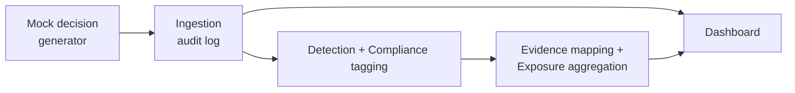

# AEGIS — AI Exposure Governance & Insurance Shield

*An AI exposure-and-coverage evidence mapper for insurance carriers running agentic AI.*

Built as an academic/enterprise-style project positioned against
Guidewire's Qusar agentic AI framework.

---

## Problem statement

In August 2026, Guidewire launched **Qusar**, an agentic AI framework
built directly into PolicyCenter, ClaimCenter and BillingCenter. It lets
carriers deploy AI agents that make real underwriting and claims decisions
on their own — approve or deny a claim, price a policy, flag a submission
as fraud — inside the same install base Guidewire already runs across
**570+ carriers in 43 countries**. Qusar also ships its own agent-level
governance controls for *how* those decisions get made.

What Qusar's own governance doesn't give a carrier is a downstream,
carrier-facing view of *what those decisions mean for exposure*: which
decisions touch which insurance risk category, which ones are missing
supporting evidence or a timely compliance review, and what auditable
trail exists if a regulator, a reinsurer, or a claims reviewer later asks
"why did the AI do this, and can you prove it was checked." Today that
evidence sits scattered across agent logs with no mapping to risk
categories and no exportable, carrier-side audit trail — so a carrier's
own compliance and underwriting teams can't independently verify
AI-driven decisions without manual, ad hoc digging. That's the specific,
narrower gap AEGIS fills — not a replacement for Qusar's governance, and
not a parallel insurance product, but the evidence layer sitting between
the two.

## Proposed solution

**AEGIS** is an exposure-and-coverage evidence mapper that sits downstream
of a carrier's own AI agents. It consumes the decision evidence those
agents already produce, identifies the ones missing supporting controls,
and turns them into an auditable record mapped to a broad insurance
exposure category. Four moving parts:

1. **Watch** — every AI-agent decision is logged with its full reasoning
   trail as it happens, independent of the agent's own internal log.
2. **Check** — an anomaly/bias engine compares each decision against
   historical patterns and flags outliers; a flagged decision is tagged
   with the disclosure standard its jurisdiction calls for (EU AI Act, UK
   FCA, IRDAI, or a US state rule) — a tag for a human reviewer to check
   against, never a certification that the decision satisfies it.
3. **Map** — every flagged (or never-reviewed) decision is mapped to a
   broad insurance exposure category — Underwriting Risk, Claims Handling,
   or Fraud & Integrity Exposure — and recorded as an audit evidence row.
4. **Export** — the accumulated evidence, plus a per-agent exposure
   summary (evidence rate, dominant exposure category), is exportable as a
   structured audit bundle a compliance or underwriting reviewer can act
   on directly.

AEGIS explicitly does **not** certify compliance, make a legal coverage
determination, or set a premium — those decisions stay with Guidewire's
own systems and the carrier's own compliance/underwriting teams. AEGIS's
job stops at making existing AI decisions visible, categorized by
exposure, and auditable.

## Why AEGIS is different

- **A narrower, feasible slice.** Rather than re-building governance Qusar
  already provides, or standing up an unvalidated insurance product with
  no coverage definitions, claims data, or actuarial backing, AEGIS does
  one thing well: turn scattered agent decision evidence into a
  carrier-facing, exportable audit trail mapped to exposure categories.
- **Evidence-first, not action-first.** AEGIS never triggers money moving
  or a binding decision on its own — every output is evidence or a
  non-binding summary for a human to act on, which is what makes it
  feasible to build and defensible to pitch within a semester project's
  scope.
- **Regulation-aware tagging, not regulation-aware certification.** A
  jurisdiction disclosure-standard map (EU, US, India and beyond) is built
  in from day one, matching Guidewire's global footprint — but it tags
  what a reviewer should check, it never claims the check passed.
- **Exposure visibility as the incentive.** Surfacing which agents
  generate the most audit evidence — and in which exposure category — is
  itself useful to a carrier's compliance and underwriting teams, without
  AEGIS overreaching into pricing or coverage decisions that belong to
  Guidewire's existing rating engines.

## About Qusar, and how AEGIS relates to it

Qusar is Guidewire's agentic AI framework, announced in August 2026,
letting carriers run AI agents directly inside PolicyCenter, ClaimCenter
and BillingCenter to handle underwriting, claims and FNOL decisions
autonomously, with its own agent-level governance controls for how those
decisions get made. It's a genuinely significant shift: for the first
time, decisions that used to require a human adjudicator can be made
end-to-end by an agent, at the scale of Guidewire's entire carrier base.

That shift is exactly what makes AEGIS useful. Qusar's own governance
controls operate at the point of decision; they don't give a carrier's
compliance and underwriting teams a consolidated, exportable view of what
those decisions mean for exposure after the fact. AEGIS is designed to sit
immediately downstream of a Qusar-style agent: every decision an agent
makes is exactly the kind of event AEGIS's ingestion layer is built to
receive, watch, and — when something needs a second look — turn into
evidence.

**In this build**, we don't have access to a live Qusar sandbox or a
public integration API, so the ingestion layer uses a `MockDecisionGenerator`
that produces events in the same shape a real Qusar agent's decision log
would take (agent id, decision type, outcome, jurisdiction, reasoning
trail). The rest of the system — detection, compliance tagging, evidence
mapping, exposure aggregation — is built against that shape, so the only
thing that would need to change with real sandbox access is the data
source itself, not the product.

## Architecture

One Spring Boot application, one Maven module, three packages — each
package a clean, independently ownable slice of the pipeline below.



| Package | Owns | Depends on |
|---|---|---|
| `com.aegis.contracts` | Shared records: `DecisionEvent`, `FlaggedDecision`, `ExposureEvidenceRecord` | — |
| `com.aegis.ingestion` | Mock decision generator, audit log, `DecisionEvent` publishing | `contracts` |
| `com.aegis.detection` | Anomaly/bias flagging, jurisdiction disclosure-standard tagging | `contracts` |
| `com.aegis.evidence` | Exposure evidence mapping, exposure aggregation, audit export, dashboard | `contracts` |

Each package's own `README.md` has its full scope, files owned, and a
ready-to-paste Claude kickoff prompt is in `docs/CLAUDE_PROMPTS.md`.

## Tech stack

| Layer | Choice |
|---|---|
| Language | Java 21 |
| Framework | Spring Boot 3 |
| Database | H2 (in-memory), swappable to Postgres later |
| Frontend | Thymeleaf (server-rendered), shared nav/footer fragments |
| Build | Maven |
| Inter-package messaging | Spring `ApplicationEvent` |

## Getting started

```bash
git clone <this repo's URL>
cd aegis
mvn spring-boot:run
```

Then open `http://localhost:8080`.

Working on one of the three slices? Read `CONTRIBUTING.md`, then your
package's own `README.md` under `src/main/java/com/aegis/<package>/`.

## Repository layout

```
aegis/
├── README.md                  ← you are here
├── CONTRIBUTING.md             ← branch workflow, how to avoid merge conflicts
├── pom.xml
├── docs/
│   └── CLAUDE_PROMPTS.md       ← copy-paste Claude kickoff prompt per person
└── src/
    ├── main/java/com/aegis/
    │   ├── AegisApplication.java
    │   ├── contracts/           ← shared records (team-owned)
    │   ├── ingestion/            ← Person A
    │   ├── detection/            ← Person B
    │   └── evidence/              ← Person C
    ├── main/resources/
    │   ├── templates/            ← layout.html (shared) + one folder per person
    │   └── static/css/
    └── test/java/com/aegis/      ← mirrors the main packages
```

## Team

3-person team, one slice each — see `CONTRIBUTING.md` for the full
workflow and each package's `README.md` for scope.
